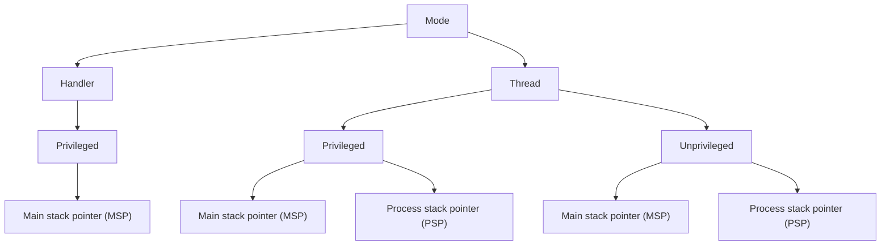

# {{ page.title }}

<time datetime="2026-06-28">Sunday, 28 Jun 2026</time>

I am trying to understand as much as Operating Systems and Cortex M4 core and here is the crux of what I understood. How scheduler wouldwork in an operating system and what would it require from hardware to make it all work!!
Then see how some of it is done in FreeRTOS as well to understand how it all works.
Note: This is all from STM32F407VET6 Chip's perspective details would differ for each chip. But generally the philosophy
would be the same.

## Hardware requirements for an OS to run
For an OS to run and perform scheduling and switching it needs some support from Hardware. Some of it is not really provided
in Cortex M series but that would be fine if you run code which is determined... 
We will cover cases of general purpose OS where you are running unknown code later.

1. For an OS to run and perform it's job of scheduling the first thing it needs is ability to seperate out when the
code is running for kernel which would have access to all the resources and parameters (kernel mode) vs when the 
code is running for process to limit the access to resources (user mode).

2. An ability for process to request to run code on it's behalf and perform some action like output to UART or some
privileged work. To be able to do this the kernel needs to map some addresses and let hardware know when the requirement comes
to call the particular set of functions. This table of mapping is called Trap table or Vector table

3. Once the process is running OS needs hardware mechanisms to make sure it can take control of the running system. OS needs
setups a timer and when the timer turns 0 an interrupt triggers calling function from the Vector table so that OS can decide 
whether to continue a process or switch to other one. For the process since it was swapped in the middle of execution without
it's control this is non-cooperative(preemptive) approach to scheduling.

4. When deciding for context switch OS needs an ability to swap Stack, all the registers the current running code address and 
the status of the current running instruction in memory and needs to load all of them for different process to execute.

## 1. ARM-v7M and Cortex M4 Core Operation states
ARM-v7M uses a memory mapped architecture where addresses between main memory (RAM and ROM) is shared with peripherals.
The configuration of processor can be modified by accessing the System Control Space(SCS) at 0xE0000000 to 0xE000EFFF (4KB).

The core can execute in 2 modes: Handler and Thread mode. Handler mode to handle all the interrupts from the processor and 
Thread mode to handle the main **business logic**. In Thread mode and Handler mode you can further seperate the execution context
of a processor in Privileged and Unprivileged mode. On reset it runs in Thread, Privileged mode and uses the Main Stack Pointer.

Generally in RTOS the threads(or tasks) use Process Stack Pointer in Unpriviliged mode and kernel works in Main Stack Pointer in Privileged mode. The interrupts execute in Handler Mode in Privileged context and using Main Stack Pointer.

The valid combinations of execution mode, privilege level, and stack pointer are shown below:

## 2. The VTOR and interrupt table
All the interrupts are handled in Handler Mode with Privileged execution and using Main Stack Pointer. The Interrupt table in STM32 (is initially mapped by the internal bootloader based on the boot option you select) are initially stored at address 0x0 but can be changed with VTOR address. In STM32 you would have NVIC Controller as well taking in interrupts from multiple sources and setting up priorities.

## 3. The System Tick Timer (Systick)
Most of the Cortex cores are included with Systick Clock running at same frequency as processor clock. The Systick is generally set up with FreeRTOS to be used as the interrupting mechanism so that FreeRTOS could switch tasks at a regular interval.

On a single core processor there can only be one task in the Running state at any given time. The scheduler in FreeRTOS would always run the Highest Priority task and run same priority tasks in round robin scheduling fashion. They call it 'Fixed Priority Preemptive Scheduling with Time Slicing'. If all tasks are in blocking stage it runs Idle task which is at priority 0. You can create tasks which share same priority as Idle too. 

So in all once you setup the Systick Timer and you map the FreeRTOS functions for SVCall and PendSV(for systemcalls). You would just need to start the scheduler.

## 4. Context Switching 
On an interrupt the Hardware automatically switches to Handler Mode with MSP set before doing that it stores **R0-R3, R12, Link Register(R14), PC(R15) and XPSR (All Status Registers)** into **Process Stack Pointer** whenever it jumps from it then if FreeRTOS decides to do a context switch it would have to store **R4-R11** and few Floating pointing register into PSP as well. After this it stores the PSP into **Task Control Block** a data structure which tracks the required data for task execution once it loads the registers of other task and returns from the interrupt(or exception). The Hardware restores all the registers unwinding the Stack. This magical context switch is what allows for multiple tasks to run.

## References
These are the main supporting material to look through.

 - [Operating Systems: Three Easy Pieces](https://pages.cs.wisc.edu/~remzi/OSTEP/) is an amazing to start if you know nothing about how
 OS works and why is it evern required.
 - [ARM v7M Architecture Guide](https://support.arm.com/documentation/ddi0403/ee/) is the main guiding document on how ARM-V7M works.
 - [FreeRTOS documentation](https://freertos.org/Documentation/02-Kernel/07-Books-and-manual/01-RTOS_book) is a great resource on embedded systems based operating systems. 
 - I was experimenting a bit with FreeRTOS and bringing up my own setup here in the following [repo](https://github.com/jr4in/stm32-scratch). The FreeRTOS code is well documented as well if you want to try reading it out.

